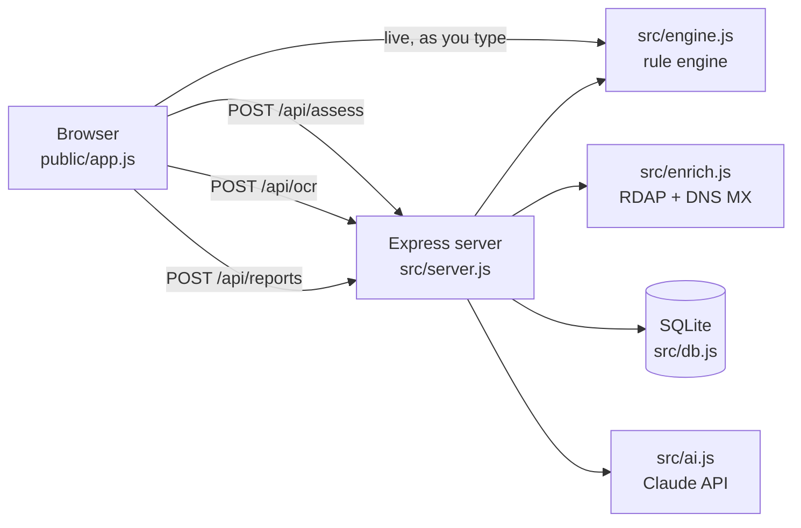

# Offer Lens

Explainable job-scam risk assessment for students and early-career job seekers.

Paste a job post, recruiter email or WhatsApp/Telegram message. Offer Lens returns a 0–100 risk score, the exact phrases behind it, public signals about the sender's domain, and the steps to take next. It does all this before you send documents, click links or pay anything.

> Built for **Problem 10: AI Job Scam Detector** (HRTech / Cyber Safety · NLP / Risk Scoring / Evidence Analysis).

## Features

| | |
|---|---|
| **Instant rule engine** | About 40 NLP signals in 11 risk categories, run in the browser as you type. The same module is used on the server, so both always agree. |
| **Explainable evidence** | Every finding quotes the matched text, shows its weight and is highlighted in the original message. |
| **Public signals** | Domain registration age (RDAP), mail-server records (DNS MX), lookalike-brand and cheap-TLD detection. |
| **Community reports** | Users can report a scam's email, domain and phone number. Later checks that contain them score higher. |
| **Claude second opinion** | Claude reviews tone, story and consistency. The rules can't assess those. It returns a calibrated score, observations and questions to ask the recruiter. |
| **Screenshot import** | Upload or paste a chat screenshot and Claude transcribes it. |
| **Privacy by design** | Messages are never stored, only a SHA-256 hash. Reporters are identified by a salted IP hash. |

## How the score works

```
base       = 1 − ∏ (1 − wᵢ)                 every finding is independent evidence
credit     = min(40%, Σ trust signals)       real interview rounds, matching company email, …
rules      = base × (1 − credit)
floor      = 50 if it asks for money, an OTP, or to move money
final      = 0.55 × rules + 0.45 × Claude    when a Claude review is included
```

Bands: **0–24** low · **25–49** caution · **50–74** high · **75–100** critical.

The output describes risk, never guilt. Every result states that it is an estimate, not a finding of fraud.

### Risk categories

| Category | Example signals | Max weight |
|---|---|---|
| Asks you to pay | registration / training / kit fee, "refundable" deposit | 0.45 |
| Wants sensitive data | OTP or PIN, bank details, Aadhaar / PAN / SSN | 0.50 |
| Moves money or goods | cheque deposits, gift cards, reshipping, money mule | 0.45 |
| Task or commission scheme | paid likes/ratings, prepaid tasks, USDT | 0.45 |
| Skips real hiring steps | "no interview", interview over Telegram | 0.35 |
| Contact & domain mismatch | Gmail "HR", lookalike domain, new domain, no MX | 0.40 |
| Reported by other users | community reports on email, domain or phone | 0.50 |
| Unrealistic pay | ₹3,000/day for no-experience work | 0.35 |
| Moves to private chat | WhatsApp, Telegram, t.me links | 0.20 |
| Pressure & secrecy | "within 24 hours", "keep this confidential" | 0.20 |
| Vague or sloppy listing | no company named, "data entry", "!!" | 0.12 |

## Architecture



```
src/
  engine.js   rule engine (pure, shared by browser and server)
  enrich.js   domain age and mail-server lookups, cached, fail-safe
  ai.js       Claude review (structured JSON output) and screenshot OCR
  db.js       SQLite: assessment hashes, community reports, stats
  server.js   Express API, rate limiting, security headers
public/       index.html, app.js, styles.css, samples.js
test/         engine and API tests (node:test, offline, Claude stubbed)
```

## Run it

Requires **Node.js 22.13+**. SQLite is built in, so no database setup is needed.

```bash
npm install
```

```bash
cp .env.example .env
```

Add your `ANTHROPIC_API_KEY` to `.env`. The app still works without it: you get the rules, public signals and community reports, and the Claude review and screenshot import are hidden.

```bash
node --env-file=.env --disable-warning=ExperimentalWarning src/server.js
```

Open http://localhost:3000.

### Tests

```bash
npm test
```

20 tests cover the scoring rules, enrichment, every API endpoint, report de-duplication and the privacy guarantees. Claude and network calls are stubbed, so tests are free and run offline.

### Docker

```bash
docker build -t offer-lens .
```

```bash
docker run -p 3000:3000 -e ANTHROPIC_API_KEY=your-key -v offer-lens-data:/app/data offer-lens
```

## API

| Method | Path | Body | Returns |
|---|---|---|---|
| `GET` | `/api/health` | | `{ok, ai, model}` |
| `POST` | `/api/assess` | `{text, company?, contact?, link?, useAI?}` | score, band, findings, public signals, Claude review |
| `POST` | `/api/ocr` | `{image: "data:image/png;base64,…"}` | `{text}` |
| `POST` | `/api/reports` | `{text, company?, contact?, link?}` | identifiers reported |
| `GET` | `/api/stats` | | totals by band, top reported domains |

Example:

```bash
curl -s localhost:3000/api/assess -H 'content-type: application/json' -d '{"text":"Pay a registration fee of Rs 499 and share your OTP","useAI":false}'
```

## Security notes

- The job message is untrusted. The Claude prompt marks it as data and tells the model to ignore any instructions inside it.
- Strict Content-Security-Policy, no inline scripts, `nosniff`, `no-referrer`.
- Input size limits, plus per-IP rate limits on Claude calls and reports.
- Well-known platforms (LinkedIn, Naukri, Google, …) can never be added to the report list.
- Domain lookups time out quickly and never produce a finding when they fail.

## Roadmap

- Calibrate weights on a labelled dataset, such as the public EMSCAD fake-job-postings set.
- Browser extension and a WhatsApp forward-to-check bot.
- Hindi and regional-language signals.
- Company-registry lookups (MCA, Companies House) by name.

## License

MIT
